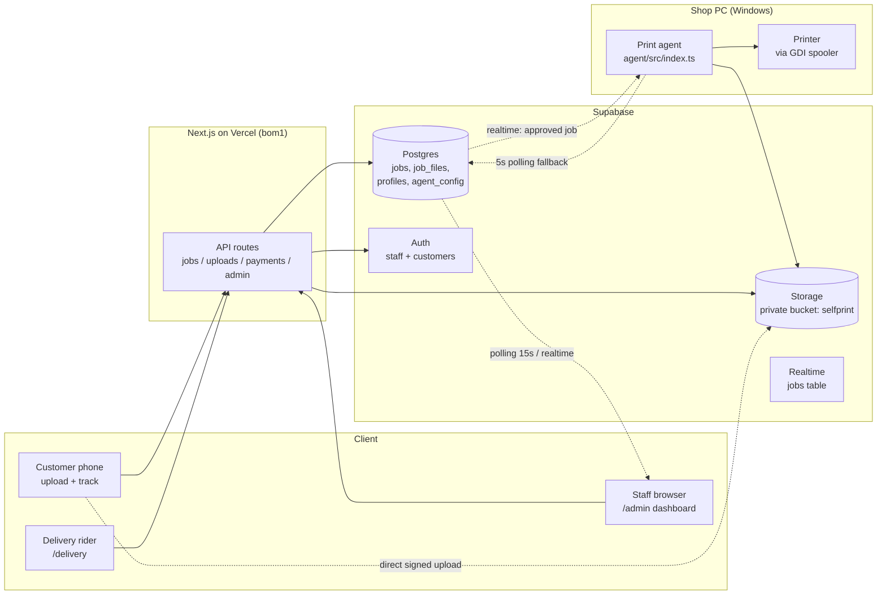
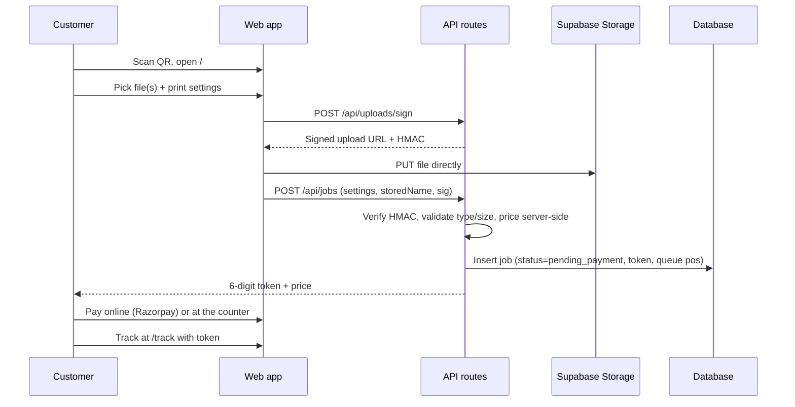
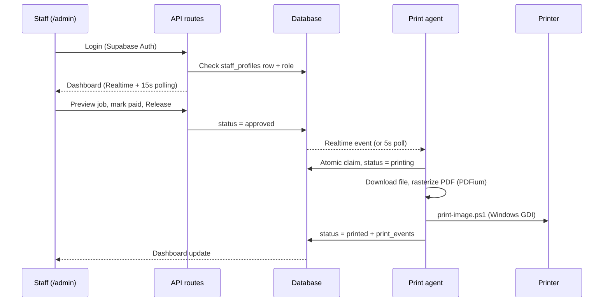
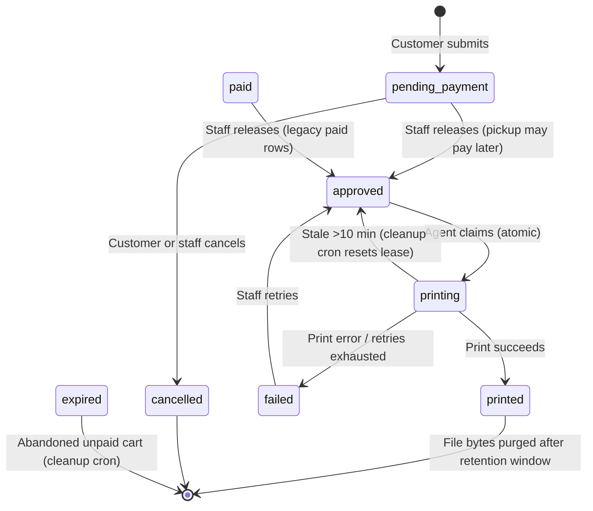
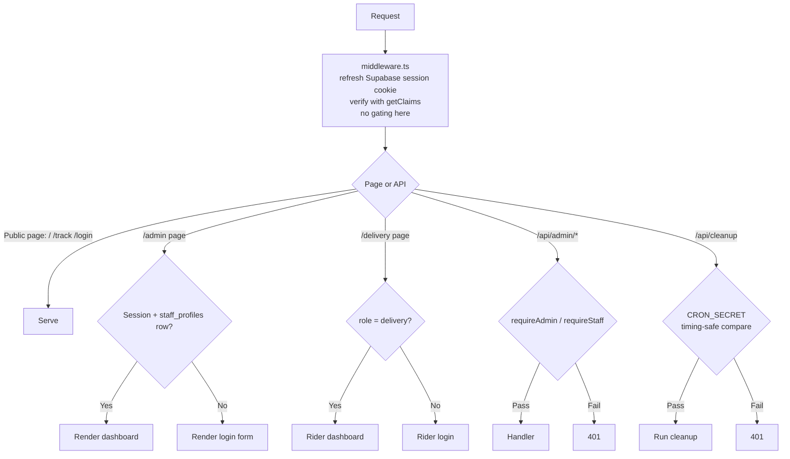

# Self_Print

QR-friendly self-service print queue for Xerox/print shops. Customers scan a QR code, upload files from their phone, pick print settings, get a token, pay online or at the counter, and staff release the job from an admin dashboard. A Windows agent on the shop PC polls approved jobs and prints them through the GDI spooler.

**Stack:** Next.js 15 (App Router) · React 19 · TypeScript · Tailwind-free custom CSS · Supabase (Postgres + Storage + Auth + Realtime) · SQLite for local dev · Razorpay · Node/TSX print agent · Vitest

**Live:** https://selfprint-six.vercel.app

---

## Quick Start

```powershell
npm install
npm run db:seed
npm run dev
```

Open http://localhost:3000. Without Supabase env vars the app runs fully local on SQLite — guest upload works, accounts and the print agent do not.

## Routes

| URL | Who | What |
|---|---|---|
| `/` | Customer | Upload PDF/JPG/PNG (single, or 2–20 PDFs in bulk) and configure print settings, delivery, add-ons |
| `/track` | Customer | Track an order by its 6-digit token; report an issue; download a receipt |
| `/login` / `/register` | Customer | Optional account — guests can upload without one |
| `/forgot-password` / `/reset-password` | Customer | Password recovery |
| `/complete-profile` | Customer | Phone capture after signup |
| `/account` | Customer | Profile editor (name, phone, avatar) |
| `/my-jobs` | Customer | Order history and saved files (login required) |
| `/delivery` | Delivery rider | Login page and delivery dashboard in one surface |
| `/staff/accept-invite` | Staff invitee | Accept an invite, set password |
| `/admin` | Staff | Live queue dashboard, printer panel, pricing, hours, agent update |
| `/admin/orders` | Staff | Order management: filters, search, batch actions |
| `/admin/jobs/[id]` | Staff | Job detail: settings, status, timeline, issue resolution, reprint |
| `/admin/jobs/[id]/print` | Staff | Manual browser-print fallback (streams the file) |
| `/admin/delivery-area` | Staff | Service-area map + pincode gating |
| `/admin/customers` | Staff | Customer directory with history and CSV export |
| `/admin/accounts` | Staff | Daily analytics and customer account administration |
| `/admin/staff` | Super admin | Staff invitations and role management |
| `/admin/security` | Staff | Login events and security review |
| `/admin/data-retention` | Staff | Retention windows and cleanup history |

## How It Works

### System Architecture



Admin and delivery dashboards poll (`/api/admin/*`, 15s admin / 10s delivery) plus a Supabase Realtime subscription on `jobs`; SSE was removed to cut Vercel billing (see [`docs/VERCEL_MEMORY_RUNBOOK.md`](docs/VERCEL_MEMORY_RUNBOOK.md)). The agent uses Realtime with a 5s polling fallback.

### Customer Order Flow



### Staff & Print Flow



### Job Status Lifecycle



Statuses: `pending_payment`, `paid` (legacy value only — new jobs never set it), `approved`, `printing`, `printed`, `failed`, `cancelled`, `expired`.
Payment is tracked independently in `paidAt`/`paidVia`, so a pickup job can print before or after the customer pays. **Exception:** delivery orders must be paid online before they can be released.

### Auth, Roles & Access Control



Roles: `super_admin` (staff management, agent updates, destructive routes), `admin` (queue, pricing, customers), `delivery` (claims delivery orders only). Staff accounts are invite-only — there is no self-service path into `staff_profiles`.

## Commands

```powershell
npm run dev         # Start dev server
npm run build       # Production build
npm start           # Serve the production build
npm run typecheck   # tsc --noEmit
npm run test        # vitest run
npm run db:seed     # Initialize/seed local SQLite
npm run cleanup     # Purge finished + expired jobs and files
npm run convert     # DOC/DOCX → PDF (needs LibreOffice)
npm run agent       # Run the Windows print agent on this machine

npm run package:shop               # Bundle a ready-to-run shop-PC agent zip
npm run package:shop -- --publish  # ...and publish it as a self-update payload
npm run agent:push-update          # Queue that update for the shop PC (CLI twin of the dashboard button)

node scripts/create-owner.mjs <email> <password>  # Create/upsert a super_admin account
```

## Setup

### Environment

Copy `.env.example` to `.env` and fill in what you need.

| Variable | Required | Purpose |
|---|---|---|
| `AGENT_TOKEN` | Yes (dev) | Seeded into `agent_tokens`; also protects `/api/cleanup` in dev when `CRON_SECRET` is unset |
| `SESSION_SECRET` | Production | HMAC key for signing upload names and local file serving. Dev fallback is insecure; boot warns if unset/default |
| `SUPABASE_URL` + `SUPABASE_SERVICE_ROLE_KEY` | Production | Switches DB + Storage from SQLite/filesystem to Supabase |
| `NEXT_PUBLIC_SUPABASE_URL` + `NEXT_PUBLIC_SUPABASE_ANON_KEY` | For login | Browser Supabase client, RLS-protected Auth |
| `NEXT_PUBLIC_SITE_URL` | Production | Canonical base URL for auth emails (falls back to `VERCEL_PROJECT_PRODUCTION_URL` → `VERCEL_URL` → localhost) |
| `CRON_SECRET` | Production | Protects `/api/cleanup` (Vercel Cron, 03:00 daily) |
| `SHOP_NAME` | Optional | Shown to customers and on receipts (default `Print Shop`) |
| `SHOP_REVIEW_URL` | Optional | Google review link; shows "Rate us" once an order completes |
| `RAZORPAY_KEY_ID` + `RAZORPAY_KEY_SECRET` (+ `RAZORPAY_WEBHOOK_SECRET`) | Optional | Online checkout and auto payment confirmation; empty → pay-at-counter only |
| `MAX_UPLOAD_MB` / `NEXT_PUBLIC_MAX_UPLOAD_MB` | Optional | Per-file cap (default 50). The `NEXT_PUBLIC_` mirror must match and needs a rebuild |
| `FILE_RETENTION_DAYS` | Optional | Days after completion before file bytes are purged (default 3; metadata kept) |
| `CART_ABANDON_MINUTES` | Optional | Abandoned unpaid cart lifetime (default 1440) |
| `STRAY_FILE_RETENTION_HOURS` | Optional | Unclaimed orphan upload lifetime (default 2) |
| `LOGIN_EVENT_RETENTION_DAYS` | Optional | Staff login audit retention (default 365) |
| `DATABASE_PATH` / `UPLOAD_DIR` | Optional | Local SQLite path and upload root (on Vercel both move under `/tmp/selfprint`) |
| `LIBREOFFICE_PATH` | Optional | Path to `soffice.exe` for DOC/DOCX conversion (auto-detected if unset) |

Retention values seeded from env can be overridden by staff in `/admin/data-retention`.

Without Supabase env vars the app runs on local SQLite — guest upload plus manual printing work; login, Realtime, and the print agent require Supabase.

### Staff Accounts

Staff are invite-only. Create the first super admin either:

- **Script:** `node scripts/create-owner.mjs <email> <password>` — creates (or reuses) the Supabase Auth user and upserts the `staff_profiles` row. Requires `SUPABASE_URL` + `SUPABASE_SERVICE_ROLE_KEY`.
- **Dashboard:** Supabase → Authentication → Add user, then insert a matching `staff_profiles` row with `role = 'super_admin'`.

After that, existing admins invite staff from `/admin/staff`.

### Shop Configuration (in `/admin`)

Everything the shop changes day-to-day lives in the dashboard, not in env vars:

- **Pricing** — per-page B/W and color rates, duplex rate, paper-size multipliers, photo rate, delivery fee, free-delivery threshold, spiral-binding slabs, cover/bond-paper add-ons. Cached in memory, invalidated on save.
- **Printer panel** — separate B/W and color printers, per-printer duplex capability; the agent re-reads this every 30s.
- **Service hours** — open/close windows (split shifts supported), `accepting_orders` kill switch, and a timed pause that auto-resumes.
- **Delivery area** — radius or pincode/area gating, drawn on a map editor; the upload form checks serviceability before accepting a delivery order.
- **Print agent** — installed version, health heartbeat, and the update button.

### Print Agent

Full non-technical walkthrough (cloud-hosted or fully local): [`docs/CLIENT_PC_SETUP.md`](docs/CLIENT_PC_SETUP.md). Developer short version:

Copy `agent/dev-tools/config.example.json` to `agent/config.json`:

```json
{
  "supabaseUrl": "https://your-project.supabase.co",
  "supabaseKey": "your-service-role-key",
  "fallbackPrinter": ""
}
```

`fallbackPrinter` is only a startup default — the real B/W and color selection comes from `agent_config.bw_printer_name` / `color_printer_name` in the dashboard.

Run `.\agent\SETUP.bat` — one script that checks Node, registers the agent to auto-start on boot (Scheduled Task `SelfPrintAgent`), and starts it now. `agent\TEST-PRINTER.bat` sends a test page. `START-PRINTER.bat`, `START-PRINTER-BACKGROUND.vbs`, `print-image.ps1`, and `updater-template.bat` are internal machinery with hardcoded relative paths — leave them in place. `agent\dev-tools\` holds developer-only scripts (superseded install helpers, `STOP-DEV-AGENT.bat`, the config template).

For a non-technical client, `npm run package:shop` builds `dist-shop-package/selfprint-agent.zip` with `node_modules` and the real config pre-installed — unzip and double-click `SETUP.bat`, no `git clone` or `npm install` on site.

### Shipping an Agent Update

New agent versions are pushed from the admin dashboard — nobody touches the shop PC again.

**Full runbook:** [`docs/AGENT_SELF_UPDATE.md`](docs/AGENT_SELF_UPDATE.md)

1. **One-time setup** (per Supabase project): apply `supabase/migrations/20260806000000_agent_self_update.sql` and create a **private** Storage bucket `agent-updates`.
2. **Bump version**: edit `agent/version.json` (must be strictly greater than the published version).
3. **Publish**: `npm run package:shop -- --publish` — builds a minimal zip, uploads it, writes `latest.json` last, deletes old zips. `kind: "code"` (just `agent/`, ~100 KB) when only scripts changed; `kind: "full"` (with `node_modules`, ~100 MB) when a runtime dependency moved.
4. **Install**: click **Update** in the admin topbar (super admin only) → Install, or run `npm run agent:push-update`. The agent picks it up via Realtime within ~1s (30s fallback poll).
5. **Watch**: the badge shows `requested → downloading → swapping → completed`. Failures and rollbacks show in red with a reason; both leave the old version running, safe to retry. Updates defer while a job is printing.

## Features

**Customer**

- Upload PDF, JPG, PNG, DOC/DOCX from mobile data; direct-to-storage signed uploads
- Print settings: B/W or color, copies, page range, paper size (A3/A4/A5/A6/B5/Letter/Legal/Photo), layout, scale, margins, duplex, pages-per-sheet (N-up)
- Bulk mode: 2–20 PDFs in one order, with per-file overrides for print type, duplex, and copies (`BulkFileCustomizePanel`); each file priced on its effective settings
- Add-ons: spiral binding (slab pricing), cover file, bond paper
- Delivery or counter pickup; delivery needs name, 10-digit phone, address, optional GPS pin, and passes the pincode/area service check inline in the upload form
- Optional accounts: order history, saved files, profile, password reset; guests tracked by token
- Token tracking page with queue position, ETA, receipt download, self-cancel, and issue reporting
- Service-worker registration for an offline app shell on production builds

**Payments**

- Razorpay Checkout (all dashboard-enabled methods), server-verified signature, idempotent webhook backup
- Pay-at-counter with staff "mark paid"; payment stored separately from status
- Refund tracking via `razorpay_payment_id`, `refund_status`, `refunded_at`
- Free-delivery threshold waives the fee automatically

**Staff**

- Live queue dashboard (Realtime + polling), order filters, search, batch payment/release/delete
- Job detail with print settings, `print_events` timeline, issue resolution, reprint, DOC→PDF conversion, manual browser print
- Separate B/W and color printer selection with duplex-capability warnings
- Customer directory with history, CSV export, and delete (registered users removed from auth + profiles; guests anonymized)
- Daily analytics, staff invites/roles, login audit, data-retention controls
- Order-hours control: split shifts, `accepting_orders` switch, timed pause with customer-facing note

**Delivery**

- `/delivery` rider surface: login, job pool, atomic claim (`claim_delivery_job` RPC), staged progress (`packed → picked_up → out_for_delivery → delivered`)
- SMS notification templates per stage (console provider by default — plug a gateway in `src/lib/sms.ts`); custom SMS text is admin-only

**Ops**

- Windows agent: Realtime + 5s polling, atomic claim, printer-presence check for multi-agent shops, PDFium rasterization, GDI printing, retries, stale-lease recovery
- Self-update through the database with health-gated rollback
- Cleanup cron: stale print leases, abandoned carts, file-byte retention, login-event retention
- One-click shop-PC package (`scripts/package-for-shop.mjs` + `agent/SETUP.bat`)

## Project Layout

```
src/app/            routes (customer, admin, delivery, api)
src/components/     pages + admin/customer UI
src/lib/            db.ts (SQLite) / db-supabase.ts / pricing / storage / security / config
agent/              shop-PC print agent (sparse: SETUP.bat + machinery)
scripts/            seed, cleanup, convert, create-owner, package-for-shop, push-agent-update
supabase/migrations/ Postgres migrations
docs/               guides and runbooks
```

Local data: `data/selfprint.sqlite`, `uploads/originals`, `uploads/converted`, agent temp in `agent-temp/`.

## Docs

| Doc | Contents |
|---|---|
| [`AGENTS.md`](AGENTS.md) | Contributor/agent briefing: architecture, commands, decisions |
| [`PROJECT.md`](PROJECT.md) | Detailed schema, pricing math, flow notes |
| [`docs/CLIENT_PC_SETUP.md`](docs/CLIENT_PC_SETUP.md) | Non-technical shop-PC setup |
| [`docs/AGENT_SELF_UPDATE.md`](docs/AGENT_SELF_UPDATE.md) | Update publishing and rollback runbook |
| [`docs/DELIVERY_GUIDE.md`](docs/DELIVERY_GUIDE.md) | Rider workflow |
| [`docs/CUSTOMER_USER_GUIDE.md`](docs/CUSTOMER_USER_GUIDE.md) | Customer-facing guide (PDF/HTML included) |
| [`docs/pricing.md`](docs/pricing.md) | Pricing model and worked examples |
| [`docs/RAZORPAY_GUIDE.md`](docs/RAZORPAY_GUIDE.md) | Razorpay setup, test → live |
| [`docs/SECURITY.md`](docs/SECURITY.md) | Threat model and hardening |
| [`docs/VERCEL_MEMORY_RUNBOOK.md`](docs/VERCEL_MEMORY_RUNBOOK.md) | Memory/billing tuning |
| [`docs/LOCAL_DEV_AUTH.md`](docs/LOCAL_DEV_AUTH.md) | Supabase Auth on localhost |

## Tests

```powershell
npm run test
```

Vitest covers pricing, print layout, bulk validation, cleanup/retention, delivery stages, service areas, SMS formatting, and SQLite↔Supabase schema parity (`src/lib/schema-parity.test.ts`) — run it after touching either DB layer.

## Known Limitations

- SMS uses a console-logging provider stub; a real gateway must be wired into `src/lib/sms.ts`.
- Agent `updateMode` only supports `"manual"` (database-pushed); anything else is refused at startup.
- `status = "paid"` is legacy from before payment was decoupled — old rows may carry it, new ones never do.
